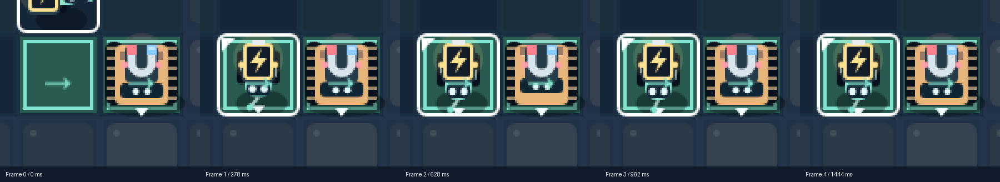

# Geschichtenpilot · Raum 04 / Schwere Fracht · 04.11.2026

> Stand 07.11.2026: Dieser Bericht beschreibt die damalige lokale Abnahme. Der Stand ist inzwischen [öffentlich veröffentlicht und neu geprüft](2026-11-07-deployment-geschichtenpilot.md). Die damaligen Aussagen „nicht veröffentlicht“ sind historisch.

Chris hat den begrenzten Geschichtenpilot ausdrücklich freigegeben, während der menschliche Test der Modulübergabe offen bleibt. Mira koordiniert und prüft den Rücklauf für den Vault. Ausgangspunkt: sauberes `main` bei `df68aca34310445668c39f3f5d9b8fad4acb5d4d`, ein lokaler Commit vor `origin/main`. Git-Status, Worktree-Liste, Maestro-Roster und Prozesse wurden geprüft: nur dieser registrierte Shift-Buddies-Agent, kein erkennbarer konkurrierender Bearbeiter. Im vorhandenen Checkout gearbeitet, ohne AutoRun, Delegation oder weiteren Worktree. Der bestehende Preview-Prozess auf 5173 (PID 2048333, gestartet am 02.11.) wurde nicht neu gestartet. Ein späterer HTTP-Lesecheck lieferte 200 und das neue lokale Build-Asset mit Auftrag und Kommentarzeile; das ist keine zusätzliche Browserabnahme des Produktionsbuilds.

## Was sich im Spiel ändert

**Auftrag:** „Bringt die Ersatzteile in die Abstellnische und verlasst gemeinsam die Werkstatt.“ Er steht im vorhandenen Aufgabenfeld; die drei Häkchen zeigen Fracht, Pip und Bolt. Die bisherigen konkreten Lösungshinweise dieses Raums werden in der Darstellung durch eine Einladung zum Beobachten und Ausprobieren ersetzt. Raumdaten und Siegprüfung bleiben unverändert.

- Pip: „Oh, hier summt’s! Strom ist da.“ Erst wenn Pip tatsächlich mit Batterie auf dem Anschluss verbunden ist. Weder T noch das bloße Erreichen des Anschlusses lösen den Kommentar aus.
- Bolt: „Die Fracht hält. Solider Kollege.“ Erst wenn die Fracht wirklich auf der Platte liegt, auch wenn Pips Strom noch angeschlossen ist. Kein vorzeitiger Kommentar beim Ausrichten, Anfahren oder gescheiterten Schiebeversuch.
- Gemeinsam am Ausgang: „Pip: Ersatzteile da. Wir auch! · Bolt: Feierabend zu zweit.“ Die vorhandene Werkstattlampe nahe dem Ausgang wird mintgrün, mit Häkchen und „DIENST ERLEDIGT“. Das Abschlussband liegt auf der unbenutzten Wand unterhalb des Raums; keine Siegüberlagerung verdeckt Roboter oder Lampe.

Pip schwenkt kurz die Antenne, Bolt nickt ruhig. Die 800-ms-Geste beginnt nach der letzten Fahrinterpolation. Sie läuft einmal pro Durchlauf: Undo und erneuter Sieg stellen die feste Bestätigung wieder her, ohne die Geste erneut abzuspielen. R oder eine neue Raumwahl erlauben einen neuen Durchlauf. Reduced motion zeigt sofort die ruhige feste Bestätigung; Ton bleibt standardmäßig aus.

## Wie es klein und nachvollziehbar bleibt

Vor der Umsetzung wurden der bestehende HUD-, Modul-, Roboter-, Feedback- und Reaktionspfad durchsucht. `src/main.ts` ergänzt die vorhandene Scene, ihren Frame-Update, Roboterrenderer und die bereits gezeichneten Werkstattlampen. `index.html` und `src/style.css` ergänzen nur eine ruhige Kommentarzeile unter dem vorhandenen Feedback. Keine neue Abhängigkeit, Mechanik oder allgemeine Story-Engine. `src/game/rules.ts`, `src/game/drive.ts` und die sechs Lösungsfolgen bleiben unverändert.

Die Kommentare sind **feste Zustandskommentare**, keine nur einmal eingeblendeten Dialoge. Genau eine passende Zeile ist sichtbar, solange ihr Zustand gilt. Eine kleine Projektion liest den echten Spielzustand; Fracht hat Vorrang vor Strom, der gemeinsame Sieg vor beiden. Undo zeigt deshalb sofort wieder den passenden früheren Kommentar, bei fehlender Versorgung verschwindet Pip. Es gibt keine Dialogwarteschlange, Nachrichtensammlung, Sprech-Timer, zusätzlichen Undo-Snapshot oder Bestätigungstaste. Die Zeile ist keine Live-Region und ihr Text wird nur bei tatsächlicher Änderung ersetzt. Wiederholte ungültige Tausche erzeugen keine zusätzlichen Textknoten oder Ansagen.

Nur der einmalige Gestenverbrauch ist Darstellungsspeicher; er verändert keine Regel. Die Geste nutzt denselben Aufräumpfad wie Fahren/Übergabe: Undo, Reset, Raumwahl, Fokus-/Sichtbarkeitsverlust, Framepause über 250 ms und Wechsel zu Reduced motion beenden sie. Es gibt keinen späteren Callback, der einen neuen Zustand überschreibt.

## Prüfungen und Belege

- `npm test`: **32/32** Regel-/Inputprüfungen bestanden, einschließlich aller sechs Lösungen und jedes vollständigen Undo-Snapshots.
- `npm run typecheck`: bestanden, auch nach der letzten Testergänzung. `npm run build`: bestanden; bekannte Phaser-Bundlegrößenwarnung bleibt.
- Erster vollständiger Chromium-Lauf: **18/19** in **4,8 Minuten**. Alle vier neuen Storyprüfungen bestanden. Eine bestehende Fahrprüfung überschritt ihre obere Zeitgrenze; siehe unten.
- Die unveränderte Fahrprüfung bestand danach separat **3/3** in **18,4 Sekunden**. **Der zweite vollständige Lauf bestand 19/19 in 4,1 Minuten**, einschließlich aller sechs Lösungen mit normaler/reduzierter Bewegung, vollständigem Undo, Fahrgefühl, Übergabe und sämtlichen vier Storyfällen. [Abschließendes Browserprotokoll](evidence/2026-11-04-geschichtenpilot/browser.log), [Typecheckprotokoll](evidence/2026-11-04-geschichtenpilot/typecheck.log). Zwischen den beiden Gesamtläufen wurden Produktcode, Testcode und Erwartungen nicht verändert.
- `git diff --check`: sauber. Eigene Diff- und Bildsichtung; keine unabhängige Review oder menschliche Spielabnahme behauptet.

Die vier zusätzlichen Browserfälle in `tests/browser.spec.ts` prüfen den Auftrag ohne Lösungshinweis, keine Reaktion durch bloßes T oder Anschlussbetreten, Pip bei tatsächlicher Versorgung, Bolt erst nach echtem Plattendienst der Fracht, Zustandsrücknahme mit Z, R und Raumwahl, unveränderte Textknoten bei wiederholtem ungültigem T, sichtbaren gemeinsamen Abschluss und die tatsächlichen Lampen-/Bodenpixel. Der Bodenausschnitt bleibt beim Sieg pixelgenau erhalten. Die Geste wird im selben Browseraufruf gestartet und durch Undo, Reset, Raumwahl, Blur und simulierte Framepause unterbrochen; auch ein Media-Wechsel zu Reduced motion beendet sie. Nach mehr als ihrer Laufzeit bleiben korrekte feste Zustände. Erneuter Sieg nach Undo startet keine neue Geste. Reduced motion liefert über mehrere Frames exakt denselben vollständigen Canvas-Hash, keine Antennen-/Kopfbewegung und ausgeschalteten Ton. Die bestehenden fünfzehn Browserfälle bleiben mit ihren Erwartungen erhalten.



Der Kontaktbogen zeigt vergrößerte Ausschnitte von fünf echten Canvas-PNGs, keine nachgezeichneten Posen. **86 Frames**, davon **42 Gestenframes mit 42 unterschiedlichen Pixelhashes** im Ausschnitt um beide Roboter. Der größte Frameabstand der Aufnahme war **36,2 ms**. [Alle Renderkoordinaten, Gestenwerte und Pixelhashes](evidence/2026-11-04-geschichtenpilot/abschluss-frames.json), [Auswahl mit Zeitangaben und Zuschnitt](evidence/2026-11-04-geschichtenpilot/auswahl.json) und die unveränderten Vollbilder [0](evidence/2026-11-04-geschichtenpilot/abschluss-frame-0.png), [1](evidence/2026-11-04-geschichtenpilot/abschluss-frame-1.png), [2](evidence/2026-11-04-geschichtenpilot/abschluss-frame-2.png), [3](evidence/2026-11-04-geschichtenpilot/abschluss-frame-3.png), [4](evidence/2026-11-04-geschichtenpilot/abschluss-frame-4.png) liegen daneben. Diese Aufnahmen stammen aus dem ersten Gesamtlauf, in dem alle vier Storyfälle bestanden.

Weitere Screenshots: [Beginn](evidence/2026-11-04-geschichtenpilot/beginn.png), [Pip bei verbundenem Strom](evidence/2026-11-04-geschichtenpilot/pip-strom.png), [Bolt bei übernehmender Fracht](evidence/2026-11-04-geschichtenpilot/bolt-fracht.png), [gemeinsamer Abschluss](evidence/2026-11-04-geschichtenpilot/abschluss.png), [Reduced motion](evidence/2026-11-04-geschichtenpilot/abschluss-reduced-motion.png). [Statische Framefolge](evidence/2026-11-04-geschichtenpilot/reduced-motion-frames.json).

### Zeitgrenzen und offene Abnahme

Der erste neue Entwicklungslauf hatte **3/4** bestandene Storyfälle: Meine Pixelprüfung erwartete die reine Bodenfarbe und übersah den bereits vorhandenen warmen Lampenschein. Die Korrektur vergleicht einen ganzen 20×20-Bodenausschnitt vor/nach dem Sieg exakt, statt eine unbeleuchtete Farbe zu unterstellen. Die Lampenfarbprüfung und alle Frame-, Gesten-, Pixelhash- und Zeitgrenzen bleiben bestehen. [Entwicklungsprotokoll](evidence/2026-11-04-geschichtenpilot/browser-development.log).

Im ersten Gesamtlauf maß die vorhandene Fahrprüfung an einer Feldgrenze **0,371140 px/ms** statt der zulässigen **0,20–0,35**. Die andere Grenze lag bei **0,278313**. Beobachtete Hostlast während des Laufs: **13,16** bei vier verfügbaren CPUs; das beweist die Ursache des Ausreißers nicht. Der Fahr-/Inputcode und diese Testgrenzen wurden nicht verändert. [Erstes Gesamtprotokoll](evidence/2026-11-04-geschichtenpilot/browser-first.log) und [ursprüngliche Messframes](evidence/2026-11-04-geschichtenpilot/timing-first.json) bleiben erhalten.

Drei unveränderte Einzelwiederholungen bestanden mit Grenzgeschwindigkeiten **0,331568 / 0,276217**, **0,263539 / 0,255606** und **0,303004 / 0,277227 px/ms**. [Protokoll](evidence/2026-11-04-geschichtenpilot/timing-repeat.log), [Messzusammenfassung](evidence/2026-11-04-geschichtenpilot/timing-repeat-summary.json) und vollständige Einzelmessungen [1](evidence/2026-11-04-geschichtenpilot/timing-repeat-1.json), [2](evidence/2026-11-04-geschichtenpilot/timing-repeat-2.json), [3](evidence/2026-11-04-geschichtenpilot/timing-repeat-3.json). Auch die Fahrprüfung bestand im zweiten Gesamtlauf; [ihre Messframes](evidence/2026-11-04-geschichtenpilot/timing-confirmation.json) bleiben erhalten. Der später grüne Lauf beweist keine stabile Zeitobergrenze unter beliebiger Hostlast. Bei Framepausen über 250 ms beendet der bereits bestehende Schutz Fahr- und Erfolgsanimationen, statt sie später nachzuholen. Das ist weiterhin eine bewusste Darstellungsgrenze.

Grenzen: lokales Headless Chromium; kein Firefox-/Safari-/itch.io-Test, kein vollständiger Zustandsraumbeweis. Fokusverlust und Framepause wurden synthetisch ausgelöst. Menschliche Lesbarkeit, Persönlichkeit, Fahrgefühl und neue Modulübergabe bleiben von Chris zu beurteilen; Hörabnahme ist offen. Die Webveröffentlichung wurde weder geprüft noch verändert.

Zum Wiederholen mit vorhandenem lokalem Chromium:

```bash
npm test
npm run typecheck
npm run build
PLAYWRIGHT_BROWSERS_PATH=.cache/playwright npm run test:browser -- --trace off
```

Der Browserlauf startet und beendet seinen eigenen temporären Devserver auf 4174; der Port muss frei sein. Die Gesamtläufe dieser Änderung nutzen `--output .cache/story-acceptance-results` beziehungsweise `.cache/story-confirmation-results`. Bildbelege und Protokolle für Mira sind zusätzlich dauerhaft in diesem Bericht unter `docs/evidence/2026-11-04-geschichtenpilot/` abgelegt.

## Kurzer Spieltest für Chris

1. Die vorhandene [lokale Vorschau](http://127.0.0.1:5173/) neu laden und **04 / Schwere Fracht** wählen. Der Prozess läuft unverändert weiter und liefert den lokal gebauten Stand. Der veröffentlichte Webstand wurde nicht aktualisiert.
2. Erst ohne Hinweis spielen: Ist der Auftrag verständlich, und ist er ein gemeinsamer Werkstattdienst? Kommt Pips kurzer Kommentar erst bei wirklich erzeugtem Strom? Klingt Bolt beim tatsächlichen Ablösen durch die Fracht ruhig und trocken?
3. Bei Strom, Fracht und Abschluss jeweils **Z** probieren, dann weiterspielen. **R** und eine andere Raumwahl prüfen. Keine alte Aussage oder Erfolgsgeste soll zurückbleiben. Mehrfaches T und Undo sollen den Spielfluss nicht mit Nachrichten unterbrechen.
4. Am Ausgang kurz zusehen: Sind beide Roboter, Pips Antennengruß, Bolts Nicken und die bestätigte Lampe erkennbar? **Z**, dann wieder hinaus: feste Bestätigung, keine erneut gestartete Feier.
5. Reduced motion im Browser/System aktivieren und nochmals abschließen: gleicher verständlicher Abschluss, keine Bewegung. Ton bleibt aus, bis du ihn selbst einschaltest.

Der menschliche Test der Modulübergabe ist weiterhin offen und wird nicht als erledigt gewertet. Bei diesem Spieltest bitte besonders beurteilen: Lesbarkeit und Ton der kurzen Zeilen, ob sie zu lang stehen bleiben, ob die kleinen Gesten ohne Erklärung auffallen und ob der Raum ohne vorweggenommene Lösung nachvollziehbar bleibt.

Keine Veröffentlichung, kein Push, Merge, Deploy, Serverrestart oder itch.io-Publish. Der Rücklauf ist lokal für Miras Prüfung; Vault-Dokumentation übernimmt Mira.
