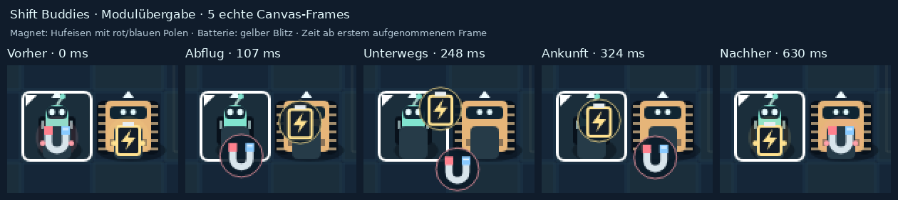

# Sichtbare Modulübergabe · 04.11.2026

> Stand 07.11.2026: Dieser Bericht beschreibt die damalige lokale Abnahme. Der Stand ist inzwischen [öffentlich veröffentlicht und neu geprüft](2026-11-07-deployment-geschichtenpilot.md). Die damaligen Aussagen „nicht veröffentlicht“ sind historisch.

Begrenzter nächster Schritt aus der [Roadmap](2026-11-03-roadmap.md), nach Chris’ positivem Fahrgefühltest. Start: sauberes `main` bei `317cbec014cda8ed8b53e5ddfd68ad690e872521`. Vor Änderung Git, Maestro-Roster/Timeline und laufende Prozesse geprüft: ein registrierter Shift-Buddies-Agent, keine erkennbare konkurrierende Arbeit; der vorhandene Preview-Prozess auf 5173 wurde nicht neu gestartet. Direkt im vorhandenen Checkout gearbeitet, ohne Delegation, AutoRun oder Worktree.

## Verhalten und Code

Ein gültiges **T** lässt Magnet und Batterie in **360 ms** gleichzeitig auf getrennten Bögen zum jeweils anderen Bot wandern. Beide bleiben aufrecht, gleich groß und verwenden ihre bisherigen Formen/Farben. Leere Halterungen und ein dezenter Hintergrund machen die Übergabe lesbar. Der bisherige reine Tausch-Leuchtring entfällt.

`src/main.ts` erweitert die bestehende Scene, deren Frame-Update und den gemeinsamen Modulrenderer. Die hintere Modulhalterung liefert zugleich die Start-/Zielkoordinaten. Die Übergabe speichert ausschließlich Renderkoordinaten und Zeit/Fortschritt: `dispatch` ändert Besitz, Verbindung und Undo sofort. Kein zweiter Spielzustand, keine zusätzliche Historie, kein Eingabemodus und keine neue Abhängigkeit. Regeln, Räume, Lösungen und Fahrgefühlcode bleiben unverändert.

Jede neue Aktion beendet die alte Übergabe am bereits gültigen Zustand. Bewegung beginnt sofort; Z stellt den alten Besitz wieder her, R/Raumwahl den Startzustand. Shift zeigt den richtigen neuen Träger. Erneutes T startet die Rückübergabe von den gültigen Halterungen. Fokusverlust, ausgeblendetes Dokument, lange Framepause und Änderung der Bewegungseinstellung verwenden den bestehenden Aufräumpfad. Es gibt keinen verzögerten Abschluss-Callback, der später Besitz überschreiben könnte. Reduced motion zeigt auch beim Tausch unmittelbar die neuen Module an den Halterungen.

## Prüfungen und Belege

- `npm test`: **32/32** Regel-/Inputprüfungen; alle sechs Lösungen und jedes vollständige Undo-Snapshot bleiben erhalten.
- `npm run typecheck` und `npm run build`: erfolgreich; bekannte Phaser-Bundlegrößenwarnung bleibt.
- `PLAYWRIGHT_BROWSERS_PATH=.cache/playwright npm run test:browser -- --trace off --output .cache/handoff-acceptance-results`: **15/15** lokale Chromium-Browserprüfungen in 3,5 Minuten. Alle sechs Räume mit normaler/reduzierter Bewegung gelöst und vollständig zurückgenommen; alle Übergabe-Abbrüche und die tatsächlichen Modulhalterungen geprüft. [Protokoll](evidence/2026-11-04-moduluebergabe/browser.log).
- `git diff --check`: sauber. Eigene Diffprüfung; keine unabhängige Review behauptet.

Der Kontaktbogen zeigt einen vergrößerten Ausschnitt echter Canvas-Aufnahmen, keine nachgezeichnete Animation. Aufgezeichnet wurden **30 Frames, davon 14 Flugframes mit 14 unterschiedlichen Pixelhashes**. Die unveränderten Vollbilder liegen als [Start](evidence/2026-11-04-moduluebergabe/frame-0.png), [Abflug](evidence/2026-11-04-moduluebergabe/frame-1.png), [unterwegs](evidence/2026-11-04-moduluebergabe/frame-2.png), [Ankunft](evidence/2026-11-04-moduluebergabe/frame-3.png) und [Ende](evidence/2026-11-04-moduluebergabe/frame-4.png) daneben. [Alle Frames mit Renderkoordinaten und Pixelhashes](evidence/2026-11-04-moduluebergabe/frames.json) und [Auswahl/Ausschnitt](evidence/2026-11-04-moduluebergabe/auswahl.json) machen die Bildfolge nachvollziehbar. Beim Sichten bleiben die rot/blauen Magnetpole und die gelbe Batterie getrennt erkennbar; am Ende sind beide an der jeweils anderen Halterung angekommen.

Die drei zusätzlichen Prüfungen in `tests/browser.spec.ts` decken getrennte horizontale/vertikale Flugbahnen, wechselnde Canvas-Pixel, korrekte Landepunkte, ungültigen diagonalen Tausch und Reduced motion einschließlich Umschalten während der Übergabe ab. Unterbrechungen werden durch DOM-Eingaben vor dem nächsten Renderframe ausgelöst: Undo, Neustart, Botwechsel, weiterer Tausch, Bewegung, E, Raumwechsel, Blur, ausgeblendetes Dokument und eine Framepause. Besitz und tatsächliche Modulhalterungen werden anschließend erneut geprüft; spätere Bewegung bleibt bedienbar. Die bestehenden zwölf Browserprüfungen bleiben erhalten, einschließlich aller sechs Lösungen mit normaler/reduzierter Bewegung und vollständigem Undo.

Der erste vollständige Lauf mit Trace-Aufzeichnung endete mit 11/15 grünen Prüfungen: Ein Lösungstipp führte laut Trace zwei statt einem Feldzug aus, zwei neue Frameprüfungen erhielten nur 6/7 statt mindestens 9 Flugframes, und ein bestehender Halte-/Resettest verfehlte seine Positionserwartung. Der Rechner war parallel belastet. Ohne Trace bestanden anschließend alle zwölf bisherigen Browserfälle und die horizontale Übergabe samt Abbrüchen. Offen blieb eine zeitabhängige Beobachtung im neuen Media-Change-Test: Dieser wartet jetzt auf das tatsächliche Media-Change-Ereignis nach Wiederaktivierung von Bewegung und beobachtet den Animationsstart im selben Browseraufruf wie T. Ein einzelner wartender Renderframe reichte dafür nicht zuverlässig; die endgültige Fassung bestand separat zweimal. Keine Fahrregel, Animationsdauer oder Frame-/Pixelanforderung wurde für die Prüfung gelockert. Der abschließende Browserlauf verwendet ausdrücklich `--trace off`; die Stabilität des instrumentierten Gesamtlaufs unter hoher Hostlast bleibt eine Grenze.

Grenzen: lokales Headless Chromium, kein menschlicher Spieltest der neuen Übergabe, keine Firefox-/Safari-/itch.io-Abnahme, kein vollständiger Zustandsraumbeweis. Fokus-/Sichtbarkeitswechsel sind synthetische DOM-Ereignisse; ein physischer Fensterwechsel wurde nicht behauptet. Kein Push, Merge, Deploy, Serverrestart oder itch.io-Publish.

## Kurzer Spieltest

1. Die vorhandene [lokale Vorschau](http://127.0.0.1:5173/) neu laden; ihr unverändert laufender Prozess liefert den neuen lokalen Build. Alternativ einen lokalen Devserver auf einem freien Port starten, z. B. `npm run dev -- --port 4174 --strictPort`. Raum **04 / Schwere Fracht** wählen: Pip und Bolt stehen bereits nebeneinander.
2. **T** drücken und kurz zusehen: Magnet von Pip zu Bolt, Batterie von Bolt zu Pip. Noch einmal T für die Rückrichtung.
3. Jeweils während der Übergabe **W**, **Z**, **R**, **Shift**, **T** oder eine andere Raumwahl auslösen. Keine Wartepflicht; Module gehören anschließend zum angezeigten gültigen Zustand. Nach W zuerst Z, um wieder nebeneinander zu stehen.
4. Reduced motion im Browser/System aktivieren: T zeigt sofort den neuen Besitz. Auch Umschalten während der Übergabe beendet die Bewegung unmittelbar.

Browserprüfung mit vorhandenem lokalem Chromium: `PLAYWRIGHT_BROWSERS_PATH=.cache/playwright npm run test:browser -- --trace off`. Der Prüflauf verwaltet seinen eigenen temporären Devserver auf 4174; dafür muss der Port frei sein. PNG-/JSON-Anhänge entstehen standardmäßig unter `test-results/`; der abschließende Abnahmelauf nutzt `.cache/handoff-acceptance-results/`.

## Nur Vorschlag für Mira: Pilotraum für Geschichte und Persönlichkeit

**Raum 04 / Schwere Fracht**: Hier lösen Pip, Bolt und Fracht bereits eine gemeinsame Werkstattaufgabe, ohne eine neue Mechanik zu benötigen.

- **Auftrag:** „Bringt die Ersatzteile in die Abstellnische und verlasst gemeinsam die Werkstatt.“
- **Pip beim Batterietausch:** „Oh, der Schacht ist meiner. Ich mach euch Strom!“
- **Bolt, wenn die Fracht die Platte übernimmt:** „Steht sicher. Jetzt kommst du auch mit.“
- **Sichtbare Erfolgsreaktion:** Beim gemeinsamen Ausgang grüßt Pip kurz mit der Antenne, Bolt nickt ruhig; eine vorhandene Werkstattlampe leuchtet bestätigt auf. Mit Reduced motion nur die feste Bestätigung.
- **Aha:** Pips Strom öffnet zuerst den Weg; Bolts Körper schiebt die Kiste in eine Nische, die durch Ziehen nicht erreichbar ist. Die Kiste übernimmt die Platte, damit Pip den Anschluss verlassen und beide hinausfahren können.

Nicht implementiert. Mira koordiniert den Folgeumfang mit Chris.
